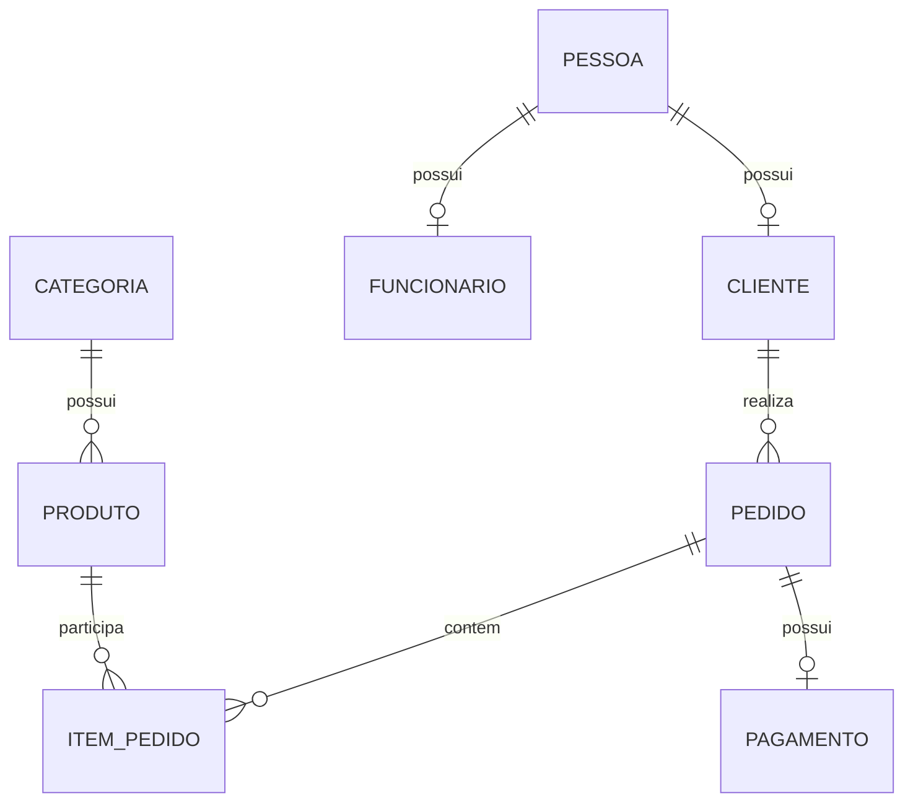

# Restaurante Studio Ghibli

Projeto desenvolvido para a disciplina de Desenvolvimento Web 1, referente ao 4º bimestre de 2026. A aplicação consiste em um restaurante temático inspirado nos filmes do Studio Ghibli, simulando o funcionamento de um estabelecimento real por meio de uma plataforma web.

## Sobre o projeto

O sistema foi desenvolvido utilizando a arquitetura Cliente/Servidor e o padrão MVC (Model-View-Controller), com integração a um banco de dados PostgreSQL.

A aplicação possui duas áreas principais: a visão do cliente, na qual é possível consultar os produtos disponíveis e realizar pedidos, e a visão administrativa, destinada ao gerenciamento do restaurante.

## Funcionalidades

### Área do cliente
- Cadastro e login de usuários.
- Controle de sessão utilizando cookies.
- Visualização dos produtos e suas categorias.
- Adição e remoção de produtos do carrinho.
- Alteração da quantidade de produtos.
- Visualização e edição dos dados do perfil.
- Estrutura de finalização de pedidos.

### Área administrativa
- Acesso restrito por login.
- Gerenciamento de produtos e categorias.
- Cadastro, edição, consulta e exclusão de registros.
- Gerenciamento de imagens dos produtos.

## Tecnologias utilizadas

- **HTML5:** estruturação das páginas.
- **CSS3:** estilização e organização visual.
- **JavaScript:** interatividade e comunicação entre cliente e servidor.
- **Node.js:** ambiente de execução do servidor.
- **Express:** gerenciamento das rotas e requisições.
- **PostgreSQL:** armazenamento e gerenciamento dos dados.

## Organização do projeto

O projeto está dividido em duas partes principais:

- **Frontend:** contém as páginas HTML, arquivos CSS e JavaScript responsáveis pela interface e interação com o usuário.
- **Backend:** contém a configuração do servidor, conexão com o banco de dados, rotas, controllers e middlewares.

O backend utiliza o padrão MVC, separando as responsabilidades de cada parte da aplicação:
- **Model:** responsável pela interação com os dados do banco.
- **View:** corresponde à interface apresentada ao usuário.
- **Controller:** responsável por processar as requisições e executar as regras de negócio.

## Banco de dados

O banco de dados foi desenvolvido em PostgreSQL, utilizando tabelas relacionadas por chaves primárias e estrangeiras.

As principais tabelas são:

| Tabela | Função |
|---|---|
| `pessoa` | Armazena os dados pessoais e de acesso dos usuários. |
| `cliente` | Identifica os usuários cadastrados como clientes. |
| `funcionario` | Identifica os funcionários do restaurante. |
| `categoria` | Armazena as categorias dos produtos. |
| `produto` | Armazena os produtos disponíveis no restaurante. |
| `pedido` | Registra os pedidos realizados. |
| `item_pedido` | Armazena os produtos pertencentes a cada pedido. |
| `pagamento` | Registra as informações de pagamento dos pedidos. |

### Diagrama do banco de dados



## Como executar o projeto

Para executar a aplicação localmente, é necessário ter o Node.js e o PostgreSQL instalados.

1. Clone o repositório do projeto.
2. Crie um banco de dados no PostgreSQL.
3. Execute o arquivo `.sql` disponibilizado no projeto para criar as tabelas e inserir os dados iniciais.
4. Configure o arquivo `.env` na pasta do backend com as informações de conexão:

```env
DB_HOST=localhost
DB_PORT=5432
DB_USER=seu_usuario
DB_PASSWORD=sua_senha
DB_NAME=nome_do_banco
```

5. Abra o terminal na pasta `backend` e instale as dependências:

```bash
npm install
```

6. Inicie o servidor:

```bash
node server.js
```

7. Abra a pasta do frontend utilizando o Live Server para acessar a aplicação.

## Autoria

**Desenvolvido por:** Yanara Karczetski de Lima
**Turma:** M32
**Disciplina:** Desenvolvimento Web 1  
**Ano:** 2026